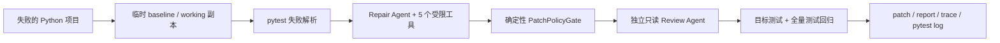

# PyRepair Agent

PyRepair Agent 是一个面向 Python 项目的安全 pytest 故障诊断与候选补丁 CLI：它使用 DeepSeek V4 Tool Calling 在临时工作区修改源码，并由确定性策略、独立 Review 和全量回归共同决定结果。

## 30 秒看懂

```text
> pyrepair fix --repo examples/buggy_bank
阶段：baseline
阶段：attempt:1
阶段：policy
阶段：review
阶段：verify
状态：success
尝试次数：1
产物目录：examples/buggy_bank/.pyrepair/runs/<run-id>
```

PyRepair 不会直接修改原仓库。成功后会留下 `fix.patch`、`report.json`、`trace.jsonl` 和 `pytest.log`，由开发者检查并决定是否应用补丁。

## 安装

需要 Python 3.11 或更高版本。

```powershell
python -m venv .venv
.\.venv\Scripts\Activate.ps1
python -m pip install -e .
```

开发环境额外安装测试工具：

```powershell
python -m pip install -e ".[dev]"
```

## 本地使用

在当前 PowerShell 会话中设置 DeepSeek API Key。不要把 Key 写进源码、README 或提交记录。

```powershell
Set-Item -Path Env:DEEPSEEK_API_KEY -Value "你的 API Key"
```

先只诊断，不调用 LLM：

```powershell
pyrepair fix --repo examples/buggy_bank --dry-run
```

生成并验证候选补丁：

```powershell
pyrepair fix --repo examples/buggy_bank --model deepseek-v4-flash
```

也可以指定一个 pytest node id：

```powershell
pyrepair fix tests/test_bank.py::test_withdraw --repo examples/buggy_bank
```

运行结束后，先查看产物，不要盲目应用补丁：

```powershell
$runDir = Get-ChildItem examples/buggy_bank/.pyrepair/runs -Directory |
    Sort-Object LastWriteTime -Descending |
    Select-Object -First 1
Get-Content "$($runDir.FullName)/fix.patch"
Get-Content "$($runDir.FullName)/report.json"
```

## 工作流



详细组件与数据流见 [架构说明](docs/architecture.md)。

## 安全边界

- 所有修改发生在临时副本，原仓库保持不变。
- Agent 只有读取、搜索、精确替换、查看 Diff、运行已识别目标测试 5 个工具。
- 只允许修改 Python 源码；禁止修改测试、CI、`.env`、密钥和依赖锁文件。
- 单次候选补丁最多修改 3 个文件、80 行增删。
- 禁止新增 `skip`/`xfail`、删除断言或弱化断言。
- 候选补丁必须通过独立只读 Review、目标测试和全量测试回归。
- 成功由 Python 规则和 pytest 判定，不由 LLM 自我声明。
- CLI 只生成候选补丁，不自动应用、不 Commit、不 Push、不创建 PR。

## 测试层次

默认测试完全离线，使用 FakeLLM，不需要 API Key，也不会产生模型费用：

```powershell
python -m pytest
python -m pytest --cov=pyrepair --cov-report=term-missing -q
python -m ruff check src tests benchmarks
```

显式运行付费 live smoke：

```powershell
python -m pytest -m live tests/test_live_deepseek.py -v
```

运行可断点续跑的 benchmark：

```powershell
python benchmarks/run_benchmark.py --model deepseek-v4-flash
```

## Benchmark 实测结果

固定数据集包含条件、边界、异常、状态和类型转换 5 类共 15 个独立单 Bug pytest 项目。完整原始记录和失败说明见 [benchmark 报告](docs/benchmark-results.md)。

| 指标 | DeepSeek V4 Flash 实测值 |
| --- | ---: |
| 端到端成功 | 13 / 15 |
| 成功率 | 86.7% |
| 首轮成功率 | 80.0% |
| 平均耗时 | 17.50 秒 |
| Prompt / Completion Token | 109,134 / 16,741 |
| 新增回归 | 0 |
| 策略拒绝 | 0 |

这是整个 PyRepair 流程的端到端成功率，不是单独的模型准确率。`case_05` 和 `case_08` 因 pytest 9 摘要格式未被当前解析器识别，在调用 LLM 前失败；这些失败保留在报告和原始 JSONL 中。DeepSeek V4 Pro 尚未评测。

## 局限

- MVP 目前只处理解析到的第一个 pytest 失败，主要面向单 Bug、小补丁任务。
- 当前解析器要求 `FAILED <node> - <detail>` 摘要形式，尚未覆盖 pytest 9 的无后缀失败摘要。
- 修改工具只支持 Python 文件内的单次精确文本替换，不执行任意 Shell 命令。
- 模型输出可能失败或产生不合格补丁，因此产物仍需要开发者审查。
- 当前公开 benchmark 只验证了 `deepseek-v4-flash`，不声称 Pro 模型效果。

## 路线图

- 支持 pytest 9 无后缀摘要和更多失败输出形态。
- 支持多个失败测试的聚类诊断与逐项验证。
- 增加开发者确认后的安全补丁应用命令。
- 在手动 GitHub Actions 演示稳定后，再评估 Issue 到候选 PR 的可选流程。

面试演示可直接照着 [2–3 分钟演示脚本](docs/demo-script.md) 操作。
