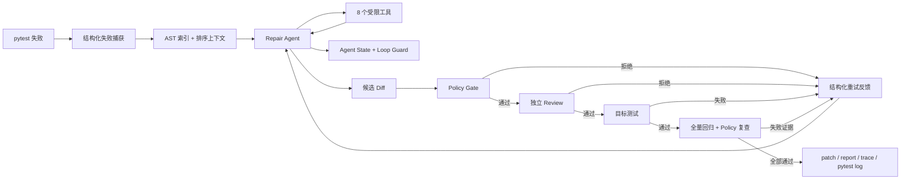

# PyRepair Agent

> 面向 Python/pytest 项目的安全候选补丁 Agent：让 LLM 负责诊断与最小修改，让确定性规则、独立 Review 和 pytest 决定能否交付。

PyRepair 不是通用编码助手，而是一套范围明确、结果可验证的自动修复闭环。它在临时副本中复现失败，通过 DeepSeek Tool Calling 收集源码证据并生成候选 Diff，最后经过 Policy、只读 Review、目标测试和全量回归共同判定。原仓库不会被 Agent 直接修改。

## 30 秒看懂

```text
pytest 失败
  → 结构化捕获失败证据
  → AST 仓库索引与确定性上下文
  → Repair Agent 调用 8 个受限工具
  → Agent State / Loop Guard 防止打转和未验证收工
  → Policy → 独立 Review → 目标测试 → 全量回归
  → 输出候选 patch、报告、trace 和 pytest 日志
```

一次修复最多进行 3 次 attempt；每次 attempt 都从同一 baseline 恢复，不叠加上一轮未经验证的改动。生成候选 Diff 后，只有通过 Policy 才进入 Review，通过 Review 才进入目标测试，目标测试通过后才运行全量回归。任一阶段失败都会被压缩成结构化反馈，交给下一轮重新制定策略。

## 为什么不是“再做一个 Claude Code”

Claude Code、Codex 等通用 Coding Agent 追求开放式开发能力；PyRepair 选择一个更窄、也更容易被工程化验证的问题：**修复一个已经能够被 pytest 复现的 Python 故障**。

| 通用 Coding Agent | PyRepair |
| --- | --- |
| 面向搜索、开发、重构等开放任务 | 聚焦 pytest 故障诊断与候选补丁 |
| 通常允许更广泛的文件和命令操作 | 只暴露 8 个受限工具 |
| 任务完成标准依赖用户目标 | 成功条件由 Policy、Review 和真实 pytest 明确定义 |
| 适合直接参与日常开发 | 适合演示可控 Agent Loop、安全门禁与可复现评测 |

项目价值不在于替代成熟通用 Agent，而在于把 **Context Engineering、Tool Use、Agent State、Loop Guard、Feedback Loop 和 Evaluation** 落到一条可以解释、测试和复现的修复链路中。

## 核心技术亮点

| 机制 | 工程价值 |
| --- | --- |
| AST 仓库索引 | 定位函数、类、方法、import 邻居，减少盲目全文搜索 |
| 确定性上下文构建 | 按失败证据排序，并以字符预算控制输入规模 |
| 8 个受限工具 | 只允许读取、搜索、符号查询、精确替换、Diff 和目标测试 |
| Agent State + Loop Guard | 检测重复调用、重复错误和无进展循环 |
| 结构化重试反馈 | 把补丁、策略、Review、目标测试和回归证据传给下一轮 |
| 多重验证门禁 | Policy、独立 Review、目标测试、全量回归共同判定 |
| 结构化 pytest 捕获 | 优先使用内部 pytest plugin 获取失败对象，异常时保守降级到文本解析 |
| 可审计产物 | 保存 patch、JSON 报告、JSONL trace 和 pytest 原始日志 |

## Agent Loop



这里有两个嵌套循环：

1. **外层 attempt loop**：最多 3 次，每轮恢复干净 working 副本；无补丁、Agent 未完成或任一门禁失败都会短路当前轮。
2. **内层 model-tool loop**：默认最多执行 8 次工具调用；运行时状态会阻止重复调用、重复错误、连续无进展，以及修改后没有查看 Diff 或运行目标测试就提前结束。

更完整的组件与数据流见 [架构说明](docs/architecture.md)。

## 快速开始

要求 Python 3.11+，并准备可用的 DeepSeek API Key。

```powershell
git clone https://github.com/JerryWu-gith/pyrepair-agent.git
cd pyrepair-agent

python -m venv .venv
.\.venv\Scripts\Activate.ps1
python -m pip install -e .

$env:DEEPSEEK_API_KEY = "your-api-key"
pyrepair fix --repo examples/buggy_bank
```

也可以指定某个 pytest node：

```powershell
pyrepair fix "tests/test_orders.py::test_total" --repo D:\path\to\project
```

只复现和解析失败、不调用 LLM：

```powershell
pyrepair fix --repo D:\path\to\project --dry-run
```

每次运行会在目标项目的 `.pyrepair/runs/<run-id>/` 生成：

| 产物 | 用途 |
| --- | --- |
| `fix.patch` | 通过全部门禁后的候选补丁；失败时为空 |
| `report.json` | 基线、attempt、Policy、Review 和 Verify 的结构化结论 |
| `trace.jsonl` | 模型轮次、工具调用统计与阶段事件 |
| `pytest.log` | baseline、目标测试和全量测试原始输出 |

## 安全边界

PyRepair 的默认原则是“生成候选补丁，不替开发者做最终写入决定”：

- Agent 工具不修改原仓库中的源码和配置，只操作系统临时目录中的 baseline/working 副本；Coordinator 会在原仓库的 `.pyrepair/runs/` 下写入审计产物。
- 不自动应用候选补丁，不自动 Commit，不自动 Push，也不自动创建 PR。
- Agent 不能执行任意 Shell，只能调用注册表中的 8 个工具。
- `replace_text` 只允许对单个、唯一匹配的 Python 源码片段做精确替换。
- Policy 拦截测试文件、环境文件、CI、锁文件、密钥、skip/xfail、断言弱化和超范围补丁。
- Review 输出无法解析时默认拒绝；目标测试未通过时不会继续全量验证。
- 仓库内容、失败信息、历史反馈和工具结果都标记为不可信数据，不能覆盖 System Prompt。

这里的“临时隔离工作区”不是 OS 或容器级安全沙箱。pytest 会执行目标仓库代码，因此**只应对可信仓库运行 PyRepair**。

## 历史 v1 Benchmark 实测

评测命令：

```powershell
python benchmarks/run_benchmark.py --model deepseek-v4-flash
```

2026-08-26 使用 `deepseek-v4-flash` 对 15 个固定、可复现的单 Bug 用例进行了一次全新非续跑评测：

| 指标 | 结果 |
| --- | ---: |
| 用例数 | 15 |
| 端到端成功 | 15 |
| 端到端成功率 | 100.0% |
| 首轮成功率 | 100.0%（15/15） |
| 平均尝试次数 | 1.00 |
| 平均耗时 | 17.09 秒 |
| 新增回归 | 0 |
| Policy 拒绝 | 0 |

这是 PyRepair 整条修复链路的端到端成功率，不是单独的模型准确率。每个成功用例都必须完成失败捕获、模型修复、Policy、Review、目标测试和全量回归；模型输出具有非确定性，单次结果不代表未来运行或真实大型仓库的固定成功率。

- 详细报告：[docs/benchmark-results.md](docs/benchmark-results.md)
- 本次原始证据：[benchmarks/results/20260826T140319Z-deepseek-v4-flash.jsonl](benchmarks/results/20260826T140319Z-deepseek-v4-flash.jsonl)
- `deepseek-v4-pro`：尚未评测

## 测试与复现

**最新评测（2026-10-25，分阶段完成）：** 18道人造＋2道已读开源dev任务，每题每方法独立运行3次，共120次方法结果。原54次保留；评测适配器修复后，另批的新66次已完成，没有重跑普通失败。

| 方法 | 合成任务 | 开源任务 | 独立核心验收合计 |
| --- | ---: | ---: | ---: |
| 完整Agent | 53/54 | 6/6 | **59/60（98.3%）** |
| 单次生成 | 35/54 | 1/6 | **36/60（60.0%）** |

Agent在more-itertools的3次扩展回归均通过766节点；单次生成该题核心未过，扩展未运行，不算扩展失败。唯一Agent失败是case_15的Decimal精度边界：内部success及Review放行，但被独立隐藏验收拒绝，失败原样保留。单次生成24次失败中14次格式、8次补丁不能应用、2次隐藏功能失败；**这是整体工作流交付能力对照，不是等预算或单组件因果结论，也不是未见任务泛化成绩。** 正式两阶段453次预留/返回、1,922,374 token；未知人民币费用与HTTP传输数不猜测。详见[最终结果、逐题三次、失败反例、用量及分阶段出处](docs/controlled-comparison-r2-results.md)。B外部扩样尚未开始；仓库提供代码、开发任务资产和汇总报告，原始运行日志及本地冻结包不随仓库发布。

开发集的“隐藏验收”指验收代码不进入Repair/Review的运行副本或模型输入，不代表这些已读开发任务的测试源码属于未公开holdout。其参考/错误补丁及验收资产随项目提供以便复现；不能据此声称训练无污染或未见任务泛化能力。

### Evaluation v2：独立隐藏验收（第一阶段）

新增评测入口与旧 `run_benchmark.py` 并存，**不修改上述 v1 历史成绩**。v2 在全新副本上应用候选补丁，用独立可见测试与隐藏测试验收，不直接把 Agent 的 `success` 当作最终成功。

- 15 个原有单 Bug 题保留源码及可见测试，补充公开任务合同、隐藏测试、参考补丁和过拟合错误补丁。
- 新增 3 个多文件人工任务：订单金额、库存预留、时区转换。18 题均为 **synthetic/dev**，不是冻结 holdout，也不是真实开源缺陷集。
- 任务预检要求：buggy 的指定失败可复现、原本通过的测试保持通过、参考补丁全通过、错误补丁通过可见测试但被隐藏测试拒绝。
- 支持独立 trial、只补未完成任务的严格续跑、持久化日志与按 Repair/Review 拆分的成本；失败和技术错误不被后续成功覆盖。
- **三次重复评测 54/54 通过**：2026-10-16 固定版本使用 `deepseek-flash`，18 题各 3 个 trial；18/18 道题均三次通过，51/54 首 attempt 通过（94.4%），多文件任务 9/9 通过。独立验收确认可见 96 项次、隐藏 111 项次通过。仅限这批 synthetic/dev 的有限重复证据，不代表真实开源缺陷或长期稳定性。见 [三次重复评测记录](docs/evaluation-v2-repeat3-run.md)，其中也保留了 Review 对同一补丁前后判定不一致的问题。
- 此前 [修复后单轮 18/18](docs/evaluation-v2-post-fix-full-run.md) 单独保留，未拼入本轮 54 次的统计。
- 历史 [首次全量运行 15/18](docs/evaluation-v2-first-full-run.md) 原样保留，其中 3 个记录器错误仍计入旧实验分母。[Windows 记录器修复](docs/evaluation-v2-recorder-fix.md) 后新建上述实验，不覆盖旧成绩；[单题冒烟](docs/evaluation-v2-live-smoke.md) 也独立保留。
- [推进与问题解决日志](docs/evaluation-v2-engineering-log.md)：按步骤记录问题、证据、处理、验证及遗留项。Review 的公开任务说明输入及固定 A/B 能力已实现；case_15 历史通过补丁存在长金额精度反例，新对照改用明确标注的人工校准正例，旧测试和成绩不回改。已完成 [36 次真实 Review 对照](docs/review-contract-live-results.md)：无说明组判断正确 16/18，有说明组 18/18，差异为两次时区正例误拒；两组均未误放 9 次反例判断。这只是定向开发样本证据，不是新版本端到端成功率。

```powershell
# 不调用模型：校验全部 18 个任务包
python benchmarks/run_evaluation.py validate

# 不调用模型：验收一份补丁
python benchmarks/run_evaluation.py grade --case case_04 --patch path/to/fix.patch

# 会调用真实模型、产生费用；正式运行前先用单题单 trial 检查
python benchmarks/run_evaluation.py run --case case_04 --trials 1 --model deepseek-flash

# 三次独立运行；trial 不是内层 attempt
python benchmarks/run_evaluation.py run --trials 3 --model deepseek-flash

# 仅补未完成 trial；已结束的失败/错误不重跑
python benchmarks/run_evaluation.py run --resume path/to/experiment
python benchmarks/run_evaluation.py report --experiment path/to/experiment
```

产物默认位于 `benchmarks/results/v2/`。每个 trial 内仍最多 3 次 attempt，每次最多 8 次工具调用；隐藏验收结果不反馈给 Agent。目录分离不是操作系统沙盒，当前仅用于可信自建任务。详见 [v2 使用与统计口径](docs/evaluation-v2.md)。

### 固定候选的 Review 对照

将 Repair 已收到的公开任务说明显式传给 Review；普通 CLI 没有任务说明时仍可按旧方式调用。说明属于不可信任务数据，Review 仍无工具、只读，非法 JSON 默认拒绝。

三题六候选已离线校准：三份正例通过可见/隐藏验收，三份反例通过可见测试但被隐藏测试拒绝；金额人工正例额外通过 18 项精度边界检查。**这不是六次模型修复成绩，也不是新 Review 准确率。** 见 [离线验收与使用说明](docs/review-contract-offline.md) 和 [候选来源](benchmarks/review_cases/README.md)。

2026-10-16 使用 `deepseek-flash` 完成 6 候选 × 2 组 × 3 重复：A 无说明组正例误拒 2/9，B 有说明组 0/9；两组反例误放均 0/9。36 次回复全部有效，无 API/解析错误；用量 75,716 Token。两次差异都来自 multi_time 的契约范围判断，运费历史误拒本次未复现。详见 [结果、逐例原因和局限](docs/review-contract-live-results.md)。

```powershell
# 不调用模型：准备新的固定输入包，已有目录拒绝覆盖
python benchmarks/run_review_evaluation.py prepare --output benchmarks/results/review/prepared-01

# 不调用模型：从已有对照运行记录重建报告
python benchmarks/run_review_evaluation.py report --experiment path/to/review-run
```

真实对照需要显式 `--live`、模型、重复次数与请求上限；上述历史 36 次已单独授权并执行，未来新实验须另确认费用，不自动追加。每次新会话、无自动重试/续跑；当前运行器遇 API/解析错误即停止，记录器失败也中断。A/B 使用同一新系统提示词，仅说明内容不同。隐藏测试和标签不进入模型，错误/未完成请求保留在全计划分母。结果在 `benchmarks/results/review/`，不纳入 Git。

### 隐蔽错误固定候选：Review hard v1

另建六题十二候选的 synthetic/dev 开发挑战集，覆盖页码边界、空白归一化、Decimal 长金额精度、跨文件取整顺序、失败操作的库存副作用，以及主流程正确但辅助接口不符合 UTC 契约。它引用原公开任务，增强隐藏验收与候选另存，不覆盖旧成绩。

十二候选已实际离线校准：六份正确参考全部通过，六份错误补丁均通过可见测试、在隐藏验收出现真实断言失败。**这是样本标签与评测工具验收，不是模型修复成绩；离线阶段没有真实 API 调用。** 来源与验证见 [离线报告](docs/review-hard-candidates-offline.md) 和 [候选集说明](benchmarks/review_cases_hard_v1/README.md)。

2026-10-19 另行授权并完成 **72 次真实 Review 对照**：A 无说明组判断正确 **24/36（66.7%）**，B 有说明组 **32/36（88.9%）**；误拒从 3/18 降至 0/18，误放从 9/18 降至 4/18。B 仍三次误放金额精度反例，并一次误放时区辅助接口反例，不能将 LLM 审查替代独立验收。72 次均有效，无 API/解析错误或补跑，记录 113,664 Token。详见 [逐候选结果、错误原因与局限](docs/review-hard-live-results.md)。这是固定开发候选的判断表现，不是新增端到端修复成功率。

```powershell
# 仅离线：冻结六题十二候选，目录必须不存在
python benchmarks/run_review_evaluation.py prepare --manifest benchmarks/manifest_review_hard_v1.json --fixtures benchmarks/review_cases_hard_v1 --output benchmarks/results/review/my-hard-prepared
```

新准备包校验实际选中的资产；补丁、契约、验收或清单变化后需重新准备。集合元数据不进入模型输入。先用 FakeLLM 验证 72 请求调度，再单独授权上述真实实验；本轮预算已用完，不自动续跑。最终启动前工程回归为 388 passed、1 项 live 未执行。

### 真实开源缺陷：独立验收试点

2026-10-22，固定上游缺陷 more-itertools r1 与 boltons r2 已通过实际 Docker 校准：原版预期断言失败、gold 公开/隐藏全通过、人工 wrong 公开通过但被隐藏断言拒绝。可信环境、安全/超时探针与独立评分器均已实测；首次失败及旧资产保留。见 [离线校准与证据](docs/opensource-pilot-offline.md)。

**这是两道已读 dev 任务与评分器的验收，不是新增模型修复成绩。** 此后另行实现受控模型对照入口并获批真实运行，最新进度见本节后续2026-10-24记录及[收尾检查表](docs/evaluation-completion-checklist.md)；该历史试点结果不与后续模型实验混合。

### Agent 自身测试：Docker 适配已离线验证

评测装配已使 Agent 的公开基线、目标测试工具和 Verifier 共用受控容器执行器，每次使用过滤快照与新容器；容器/协议/清理故障停止，不回退宿主。默认 CLI、修复策略与预算不变，隐藏验收仍由独立评分器执行。

2026-10-22：774项离线工程测试通过（6项live/docker排除）；另行显式运行5项实际Docker集成全部通过，同一新环境的两题独立评分器重校准2/2 valid。覆盖FakeLLM完整修复链及两题上游公开原版/参考补丁执行，**不是付费模型修复率，也不表示普通CLI已有Docker沙盒开关**。证据、排错与限制见[适配验收报告](docs/agent-docker-adapter-offline.md)。

### 公平工作流对照：离线实现与冻结进度

公平工作流对照在当前源码下完成新20题离线校准/冻结（18道synthetic v3＋2道opensource v3，20/20 valid）及120槽位脚本模拟/恢复；单次补丁与完整Agent共享初始公开事实。原离线CLI仍只有prepare/verify/simulate；新增独立受控入口默认inspect，不创建批准清单或额度。未来显式execute/resume必须另有匹配冻结身份、模式、顺序及调用上限的人工授权，旧开源live拒绝不删除。

more-itertools r2将核心验收（19个相关上游＋3个公开＋4个原隐藏测试）与原选定文件的扩展回归分开记录：固定3次核心校准均有效，参考补丁通过766节点扩展回归。**核心通过不等于扩展通过，超时仍是未验证；这些都是离线校准，不是模型修复率。** 旧任务、此前超时和写入失败全部保留，不宣称已根治上游时延波动。历史快照见[分层离线报告](docs/fair-workflow-comparison-offline.md)；原入口阶段的930项离线回归及2项实际Docker/FakeLLM跨进程测试见[入口历史报告](docs/controlled-live-comparison-offline.md)，最新冻结见下述报告。正式API对照与预算仍需另行确认。

2026-10-23单题真实冒烟：固定more r2、1trial、两方法各1次，记录21/37次ModelClient预留/返回；两方法均未交付可验收补丁。single-shot的Diff有不完整hunk；完整Agent暴露Windows编辑工具把LF写为CRLF、整文件Diff触发80行门禁的问题。**这不是20题正式结果，不能据此外推总体成功率；内部目标测试通过也不等于独立验收通过。** 用量、失败和恢复不重执行见[真实冒烟记录](docs/controlled-live-comparison-smoke.md)。

后续已仅离线修复编辑工具的换行保留：新增20项边界回归，完整离线950项通过，显式Docker/FakeLLM集成3项通过；大LF文件只改一行时Diff为新增/删除各1行，原80行门禁不变。该阶段没有补跑模型或回填旧成绩，旧包仍仅代表历史版本，见[换行修复验收](docs/replace-text-newlines-offline.md)。

最新离线检查点：修正smoke标题与计划轮数说明，完整回归957项通过（9项live/docker排除）；全新20题包核心校准20/20 valid、132个独立容器清理/完整性错误0，more三轮核心及参考766节点扩展通过。120槽位脚本模拟/恢复完成，4组模型比例仍为null；默认inspect明确NOT AUTHORIZED、不创建执行目录。源码与任务身份均已重新冻结，仍未新增真实模型请求、补跑旧成绩或Git发布。新包身份与证据见[报告修复及新冻结记录](docs/report-scope-refreeze-offline.md)，下一步真实冒烟需单独授权。

2026-10-24随后单独获批的新smoke：共8/37次ModelClient预留/返回，完整Agent第1个attempt交付补丁，通过独立公开22节点＋隐藏4节点核心验收及766节点扩展；真实Diff仅+12/-0，未再出现整文件换行变化。单次候选因修改允许范围外的文件被拒，未运行功能测试。**另发现按题路径白名单未明确公开给两方法，因此不能据此公平声称完整Agent优于单次生成；正式对比前应补齐共享公开约束。** 不放宽评分、不回填或补跑，剩余29次不自动使用；不是20题正式成绩。新结果、用量及未解决协议问题见[修复后真实冒烟记录](docs/controlled-live-comparison-smoke-after-fixes.md)。

2026-10-24后续离线修正已完成：共享TASK新增与评分清单一致的允许修改文件范围，经既有链路同传single-shot、Repair及Review；输入/事实策略升级r2，生产Agent和评分器不变。完整离线982项通过（9项live/docker排除）、显式Docker双方法/Review链路1项通过；新20题核心校准20/20 valid，more三轮核心与参考766节点扩展通过，132个校准容器完整性/清理错误0。新冻结包verify和120槽位脚本模拟/恢复通过，real_model_trials=0、模型比例仍为null。**公开范围提供文件级线索，该版本评估已告知修改范围后的修复能力，不宣称未知仓库完整定位。** 身份与证据见[共享公开范围离线记录](docs/public-edit-scope-offline.md)；本轮模型请求0、未Git发布，旧结果不覆盖，新真实运行仍需单独授权。

**2026-10-24历史中断检查点（原件保留）：** r2 smoke正常结束（8次）；原formal在55个结束记录处停止：54次正常、1次评测器技术错误、65次未运行，当时Agent27/27、single19/27，不能外推全计划。默认对象repr地址变化被误判为基线变化，发生在模型调用前。**2026-10-25后续已另批最小修复和66次独立续跑，现已分阶段覆盖120/120**，Agent59/60、single36/60；不覆盖旧中断记录、不补跑普通失败、不冒充同一未变化执行版本。原阶段181次＋新阶段272次预留/返回，加独立r2 smoke8次为461次、2,031,040 token；不是其它旧实验的总账。人民币费用/HTTP次数未知，B未开始，无Git发布。见[最终报告与全部出处](docs/controlled-comparison-r2-results.md)。

### 合成修复评测：金额精度新协议

新增显式清单`benchmarks/manifest_synthetic_v3.json`，仍为18题synthetic/dev；仅case_15升级至revision2，其余17题及全部公开输入保持不变。已校准的18项Decimal精度边界进入正式隐藏验收，人工gold通过，Decimal乘法候选及旧gold均被新验收拒绝。实际18/18题包校准与687项项目离线回归通过。见 [来源、验收矩阵与使用方式](docs/synthetic-precision-offline.md)。

旧默认清单和旧54/54不覆盖；本节校准时尚无新集合模型成绩，现有2026-10-25分阶段对照已单独记录（18题Agent53/54、single35/54），不沿用旧分数。下列命令仍只做离线校准，不调用模型：

```powershell
python benchmarks/run_evaluation.py validate --manifest benchmarks/manifest_synthetic_v3.json --output benchmarks/results/v2/my-new-precision-validation
```

输出目录必须不存在；重复执行请用新目录，不能覆盖旧证据。

运行全部离线测试：

```powershell
python -m pytest -m "not live"
```

运行静态检查和构建：

```powershell
python -m ruff check src tests benchmarks
python -m build
```

显式验证真实 DeepSeek Tool Calling（会产生 API 调用）：

```powershell
python -m pytest -m live tests/test_live_deepseek.py -v
```

Benchmark runner 会为每个 case 创建独立临时副本，并逐条追加 JSONL。评测失败不会被删除；`--resume` 只用于中断恢复，正式刷新指标时不使用。

## 代码导读

建议按下面顺序阅读：

| 文件 | 重点 |
| --- | --- |
| `src/pyrepair/cli.py` | Typer 入口和依赖装配 |
| `src/pyrepair/coordinator.py` | baseline、attempt、Policy、Review、Verify 总编排 |
| `src/pyrepair/testing.py` | pytest 子进程与结构化捕获降级 |
| `src/pyrepair/repository_index.py` | AST 符号与 import 索引 |
| `src/pyrepair/context_builder.py` | 确定性打分、字符预算和防注入包裹 |
| `src/pyrepair/tools.py` | 8 个工具及权限边界 |
| `src/pyrepair/agent_state.py` | 工具调用状态、指纹和验证标志 |
| `src/pyrepair/loop_guard.py` | 重复、错误、无进展与收工门禁 |
| `src/pyrepair/repair_agent.py` | DeepSeek model-tool loop |
| `src/pyrepair/feedback.py` | 跨 attempt 的结构化失败反馈 |
| `src/pyrepair/verifier.py` | 目标测试、全量测试、回归和 Policy 复查 |

## 当前局限

- 只支持 Python/pytest，且修复动作只有已有文件内的精确文本替换。
- 当前成功条件要求全量测试退出码为 0；包含无关预存在失败的仓库需要更明确的 baseline 语义。
- 测试和敏感文件保护主要依赖路径分类与静态规则，不能替代容器或虚拟机隔离。
- AST 索引在一次 attempt 内不会随编辑增量刷新，修改后的语义查询可能返回旧位置。
- v1的15题及v2的18题为小型人工开发任务；最新分阶段对照另含2道已读开源dev题，仍不是冻结后的外部验收集。隐藏验收不等于未见任务，不等价于大型真实仓库或SWE-bench成绩。
- 当前只适配 DeepSeek V4 Flash/Pro 的 OpenAI-compatible API；Pro 尚未完成正式评测。

## 路线图

1. 建立全量 baseline，区分预存在失败与候选补丁引入的回归。
2. 加固 `conftest.py`、非标准测试文件名和测试中立化修改的确定性检测。
3. 在源码编辑后增量刷新 AST 索引，并让测试失败模式变化参与进展判断。
4. 在 v2 独立验收与重复运行基础上，加入容器执行、真实开源缺陷、冻结 holdout 和同条件消融实验。
5. 保持默认仅生成候选补丁；自动应用、Commit、Push 和 PR 不进入安全默认路径。
