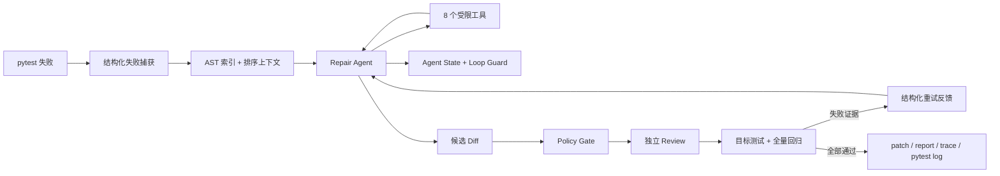

# PyRepair Agent

> 面向 Python/pytest 项目的安全候选补丁 Agent：让 LLM 负责诊断与最小修改，让确定性规则、独立 Review 和 pytest 决定能否交付。

PyRepair 不是通用编码助手，而是一套范围明确、结果可验证的自动修复闭环。它在临时副本中复现失败，通过 DeepSeek Tool Calling 收集源码证据并生成候选 Diff，最后经过 Policy、只读 Review、目标测试和全量回归共同判定。原仓库不会被 Agent 直接修改。

## 30 秒看懂

```text
pytest 失败
  → 结构化捕获失败证据
  → AST 仓库索引与确定性上下文
  → Repair Agent 调用 8 个受限工具
  → Agent State / Loop Guard 防止打转和未验证收工
  → Policy → 独立 Review → 目标测试 → 全量回归
  → 输出候选 patch、报告、trace 和 pytest 日志
```

一次修复最多进行 3 次 attempt；每次 attempt 都从同一 baseline 恢复，不叠加上一轮未经验证的改动。失败证据会被压缩成结构化反馈，交给下一轮重新制定策略。

## 为什么不是“再做一个 Claude Code”

Claude Code、Codex 等通用 Coding Agent 追求开放式开发能力；PyRepair 选择一个更窄、也更容易被工程化验证的问题：**修复一个已经能够被 pytest 复现的 Python 故障**。

| 通用 Coding Agent | PyRepair |
| --- | --- |
| 面向搜索、开发、重构等开放任务 | 聚焦 pytest 故障诊断与候选补丁 |
| 通常允许更广泛的文件和命令操作 | 只暴露 8 个受限工具 |
| 任务完成标准依赖用户目标 | 成功条件由 Policy、Review 和真实 pytest 明确定义 |
| 适合直接参与日常开发 | 适合演示可控 Agent Loop、安全门禁与可复现评测 |

项目价值不在于替代成熟通用 Agent，而在于把 **Context Engineering、Tool Use、Agent State、Loop Guard、Feedback Loop 和 Evaluation** 落到一条可以解释、测试和复现的修复链路中。

## 核心技术亮点

| 机制 | 工程价值 |
| --- | --- |
| AST 仓库索引 | 定位函数、类、方法、import 邻居，减少盲目全文搜索 |
| 确定性上下文构建 | 按失败证据排序，并以字符预算控制输入规模 |
| 8 个受限工具 | 只允许读取、搜索、符号查询、精确替换、Diff 和目标测试 |
| Agent State + Loop Guard | 检测重复调用、重复错误和无进展循环 |
| 结构化重试反馈 | 把补丁、策略、Review、目标测试和回归证据传给下一轮 |
| 多重验证门禁 | Policy、独立 Review、目标测试、全量回归共同判定 |
| 结构化 pytest 捕获 | 优先使用内部 pytest plugin 获取失败对象，异常时保守降级到文本解析 |
| 可审计产物 | 保存 patch、JSON 报告、JSONL trace 和 pytest 原始日志 |

## Agent Loop



这里有两个嵌套循环：

1. **外层 attempt loop**：最多 3 次，每轮恢复干净 working 副本，再经历 Policy、Review 和 Verify。
2. **内层 model-tool loop**：默认最多执行 8 次工具调用；运行时状态会阻止重复调用、重复错误、连续无进展，以及修改后没有查看 Diff 或运行目标测试就提前结束。

更完整的组件与数据流见 [架构说明](docs/architecture.md)。

## 快速开始

要求 Python 3.11+，并准备可用的 DeepSeek API Key。

```powershell
git clone https://github.com/JerryWu-gith/pyrepair-agent.git
cd pyrepair-agent

python -m venv .venv
.\.venv\Scripts\Activate.ps1
python -m pip install -e .

$env:DEEPSEEK_API_KEY = "your-api-key"
pyrepair fix --repo examples/buggy_bank
```

也可以指定某个 pytest node：

```powershell
pyrepair fix "tests/test_orders.py::test_total" --repo D:\path\to\project
```

只复现和解析失败、不调用 LLM：

```powershell
pyrepair fix --repo D:\path\to\project --dry-run
```

每次运行会在目标项目的 `.pyrepair/runs/<run-id>/` 生成：

| 产物 | 用途 |
| --- | --- |
| `fix.patch` | 通过全部门禁后的候选补丁；失败时为空 |
| `report.json` | 基线、attempt、Policy、Review 和 Verify 的结构化结论 |
| `trace.jsonl` | 模型轮次、工具调用统计与阶段事件 |
| `pytest.log` | baseline、目标测试和全量测试原始输出 |

## 安全边界

PyRepair 的默认原则是“生成候选补丁，不替开发者做最终写入决定”：

- 不直接修改原仓库，只操作系统临时目录中的 baseline/working 副本。
- 不自动应用候选补丁，不自动 Commit，不自动 Push，也不自动创建 PR。
- Agent 不能执行任意 Shell，只能调用注册表中的 8 个工具。
- `replace_text` 只允许对单个、唯一匹配的 Python 源码片段做精确替换。
- Policy 拦截测试文件、环境文件、CI、锁文件、密钥、skip/xfail、断言弱化和超范围补丁。
- Review 输出无法解析时默认拒绝；目标测试未通过时不会继续全量验证。
- 仓库内容、失败信息、历史反馈和工具结果都标记为不可信数据，不能覆盖 System Prompt。

这里的“临时隔离工作区”不是 OS 或容器级安全沙箱。pytest 会执行目标仓库代码，因此**只应对可信仓库运行 PyRepair**。

## Benchmark 实测

评测命令：

```powershell
python benchmarks/run_benchmark.py --model deepseek-v4-flash
```

2026-08-26 使用 `deepseek-v4-flash` 对 15 个固定、可复现的单 Bug 用例进行了一次全新非续跑评测：

| 指标 | 结果 |
| --- | ---: |
| 用例数 | 15 |
| 端到端成功 | 15 |
| 端到端成功率 | 100.0% |
| 首轮成功率 | 100.0% |
| 平均尝试次数 | 1.00 |
| 平均耗时 | 16.39 秒 |
| 新增回归 | 0 |
| Policy 拒绝 | 0 |

这是 PyRepair 整条修复链路的端到端成功率，不是单独的模型准确率。每个成功用例都必须完成失败捕获、模型修复、Policy、Review、目标测试和全量回归；模型输出具有非确定性，单次结果不代表未来运行或真实大型仓库的固定成功率。

- 详细报告：[docs/benchmark-results.md](docs/benchmark-results.md)
- 本次原始证据：[benchmarks/results/20260826T133842Z-deepseek-v4-flash.jsonl](benchmarks/results/20260826T133842Z-deepseek-v4-flash.jsonl)
- `deepseek-v4-pro`：尚未评测

## 测试与复现

运行全部离线测试：

```powershell
python -m pytest -m "not live"
```

运行静态检查和构建：

```powershell
python -m ruff check src tests benchmarks
python -m build
```

显式验证真实 DeepSeek Tool Calling（会产生 API 调用）：

```powershell
python -m pytest -m live tests/test_live_deepseek.py -v
```

Benchmark runner 会为每个 case 创建独立临时副本，并逐条追加 JSONL。评测失败不会被删除；`--resume` 只用于中断恢复，正式刷新指标时不使用。

## 代码导读

建议按下面顺序阅读：

| 文件 | 重点 |
| --- | --- |
| `src/pyrepair/cli.py` | Typer 入口和依赖装配 |
| `src/pyrepair/coordinator.py` | baseline、attempt、Policy、Review、Verify 总编排 |
| `src/pyrepair/testing.py` | pytest 子进程与结构化捕获降级 |
| `src/pyrepair/repository_index.py` | AST 符号与 import 索引 |
| `src/pyrepair/context_builder.py` | 确定性打分、字符预算和防注入包裹 |
| `src/pyrepair/tools.py` | 8 个工具及权限边界 |
| `src/pyrepair/agent_state.py` | 工具调用状态、指纹和验证标志 |
| `src/pyrepair/loop_guard.py` | 重复、错误、无进展与收工门禁 |
| `src/pyrepair/repair_agent.py` | DeepSeek model-tool loop |
| `src/pyrepair/feedback.py` | 跨 attempt 的结构化失败反馈 |
| `src/pyrepair/verifier.py` | 目标测试、全量测试、回归和 Policy 复查 |

## 当前局限

- 只支持 Python/pytest，且修复动作只有已有文件内的精确文本替换。
- 当前成功条件要求全量测试退出码为 0；包含无关预存在失败的仓库需要更明确的 baseline 语义。
- 测试和敏感文件保护主要依赖路径分类与静态规则，不能替代容器或虚拟机隔离。
- AST 索引在一次 attempt 内不会随编辑增量刷新，修改后的语义查询可能返回旧位置。
- 15 个 Benchmark case 是小型固定单 Bug 任务，不等价于大型真实仓库或 SWE-bench。
- 当前只适配 DeepSeek V4 Flash/Pro 的 OpenAI-compatible API；Pro 尚未完成正式评测。

## 路线图

1. 建立全量 baseline，区分预存在失败与候选补丁引入的回归。
2. 加固 `conftest.py`、非标准测试文件名和测试中立化修改的确定性检测。
3. 在源码编辑后增量刷新 AST 索引，并让测试失败模式变化参与进展判断。
4. 扩充多文件、多失败和真实开源仓库评测集，增加多次重复运行的稳定性指标。
5. 保持默认仅生成候选补丁；自动应用、Commit、Push 和 PR 不进入安全默认路径。
