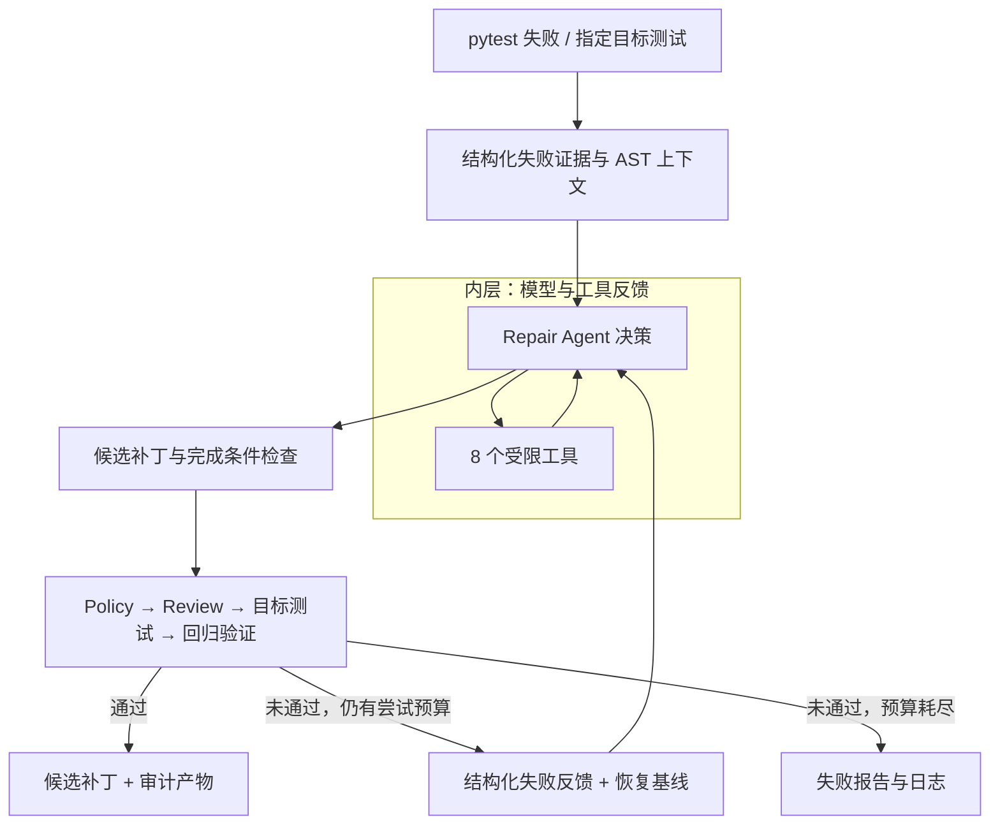

# PyRepair Agent

**基于 pytest 反馈的 Python 代码修复 Agent**

从可复现的测试失败出发，通过工具调用定位问题、生成最小候选补丁，再用规则门禁、独立 Review 和测试验证修改。默认不直接改动原仓库源码，也不自动提交或推送。

Python 3.11+ · DeepSeek Tool Calling · AST 上下文工程 · Agent 运行约束 · Docker 独立评测

[核心设计](#核心设计) · [工作流程](#工作流程) · [评测结果](#评测结果) · [快速开始](#快速开始) · [源码导航](#源码导航)

## 项目定位

PyRepair 聚焦一个明确的问题：**如何把一次 pytest 失败，转化为有修改依据、有验证证据、可供人工审阅的候选补丁。**

项目将模型决策与工程控制分开：LLM 负责定位和修复，运行时约束工具行为，确定性规则与测试决定候选是否可以交付，独立评测再检查内部流程是否误报成功。

## 核心设计

| 能力 | 实现方式 |
| --- | --- |
| 双层修复闭环 | 外层最多 3 次修复尝试；内层执行“模型决策 → 工具调用 → 结果反馈”，失败后恢复基线并传递结构化证据 |
| 上下文工程 | pytest 插件优先捕获结构化失败，异常时降级解析；结合 AST 符号与 import 索引，按相关性和字符预算选择上下文 |
| 受限工具调用 | 8 个工具覆盖源码读取、检索、符号/引用查询、模块检查、精确替换、Diff 查看与目标测试，不提供任意 Shell |
| 运行时控制 | Agent State 跟踪修改与验证状态，Loop Guard 检测重复调用、重复错误和无进展，Completion Policy 约束提前收工 |
| 分层验证 | 候选依次通过 Patch Policy、只读 LLM Review、目标测试和回归验证；Review 无法解析时默认拒绝 |
| 独立评测 | 在 Docker 中隔离运行公开测试与隐藏验收，分开统计核心验收和扩展回归，不将 Agent 自报成功直接当作最终成绩 |
| 可审计产物 | 保存候选补丁、结构化报告、JSONL 事件流和 pytest 日志；评测记录按 Repair/Review 拆分调用与 Token 用量 |

## 工作流程



每次外层尝试都从同一基线恢复，不叠加上一轮未经验证的改动。无补丁、Agent 未完成或验证关卡拒绝都会终止当前尝试；只有前置关卡通过才进入后续验证。

## 评测结果

使用 `deepseek-flash`，在 **20 个开发任务**上进行双方法对照：18 个自建任务（含 3 个多文件任务）与 2 个真实开源缺陷，每题每方法独立重复 3 次，共 **120 次方法运行**。

两方法使用相同初始公开材料、允许修改文件清单及独立评分器；每次从干净副本开始，候选需在独立验收中通过公开与隐藏测试。

| 方法 | 自建任务：18 × 3 | 开源缺陷：2 × 3 | 独立核心验收合计 |
| --- | ---: | ---: | ---: |
| **完整 Agent 工作流** | **53/54** | **6/6** | **59/60（98.3%）** |
| 单次生成补丁 | 35/54 | 1/6 | 36/60（60.0%） |

- **开源回归：** more-itertools 的 3 次 Agent 修复均通过每轮 766 个测试节点的选定上游扩展回归；这不是整个上游仓库的全部测试。
- **独立验收的实际作用：** 发现 1 次内部测试与 Review 放行、但被隐藏金额精度边界拒绝的修复；该失败按原结果保留，未选择性重跑。
- **评测资产校准：** 检查缺陷版本可复现、参考补丁通过，以及针对性错误补丁被隐藏验收拒绝。

> 这是已读开发集上的整体工作流对照，Agent 使用更多模型调用与 Token，并非等预算比较。评测分阶段完成，不代表未见任务的泛化水平。执行协议、逐题结果、失败分类和成本见[完整评测报告](docs/controlled-comparison-r2-results.md)。

## 快速开始

### 1. 安装

```powershell
git clone https://github.com/JerryWu-gith/pyrepair-agent.git
cd pyrepair-agent

python -m venv .venv
.\.venv\Scripts\Activate.ps1
python -m pip install -e ".[dev]"
```

以上为 Windows PowerShell 示例；macOS/Linux 将激活命令替换为 `source .venv/bin/activate`。待修复项目的依赖也需安装在当前 Python 环境中。

### 2. 先检查失败，不调用模型

```powershell
pyrepair fix --repo examples/buggy_bank --dry-run
```

该命令只复现并解析测试失败，不需要 API Key，也不生成修复补丁。

### 3. 生成候选补丁

```powershell
$env:DEEPSEEK_API_KEY = "<your-api-key>"
pyrepair fix --repo examples/buggy_bank --model deepseek-flash
```

也可以指定一个 pytest 测试节点：

```powershell
pyrepair fix "tests/test_bank.py::test_withdraw_reduces_balance" --repo examples/buggy_bank --model deepseek-flash --max-attempts 3
```

真实修复会调用模型并产生费用。API Key 从环境变量读取，不应写入源码或提交到仓库。

### 4. 查看产物

运行结束后，终端会显示产物目录。产物位于**目标项目**的 `.pyrepair/runs/<run-id>/`，示例项目对应 `examples/buggy_bank/.pyrepair/runs/<run-id>/`。

| 文件 | 内容 |
| --- | --- |
| `fix.patch` | 通过全部内部关卡后写入的候选补丁；未成功时为空 |
| `report.json` | 失败证据、各次尝试和验证结论 |
| `trace.jsonl` | 模型轮次、工具调用与阶段事件 |
| `pytest.log` | 基线、目标测试和回归的原始输出 |

PyRepair 不会自动将候选补丁应用到原仓库。开发者可先检查 Diff、测试证据与报告，再决定是否采用。

## 运行边界

- 普通 CLI 在本地执行 pytest，**仅对可信仓库使用**；临时工作副本不等于操作系统安全沙箱。Docker 隔离用于受控评测链路，不是普通 CLI 的默认开关。
- 工具仅修改临时副本中的已有 Python 源码。测试、配置、依赖、密钥和明显的断言弱化等修改受规则门禁约束，但静态规则不能保证覆盖所有绕过方式。
- Review 是辅助审查，不是正确性证明；已有测试通过也不代表满足所有业务条件，因此评测另设独立隐藏验收。
- 默认不自动应用补丁、不执行 Git Commit/Push、不创建 Pull Request。
- 公开开发集中的“隐藏”指验收代码不进入修复角色的工作副本或模型输入，不等于未公开的外部留出集。

## 源码导航

理解主干可从 `cli.py → coordinator.py → repair_agent.py` 开始，再沿各阶段查看组件。

| 模块 | 关注点 |
| --- | --- |
| [CLI 与装配](src/pyrepair/cli.py) | 参数解析、依赖装配、结果输出 |
| [修复编排](src/pyrepair/coordinator.py) | 基线、外层重试、验证顺序与统一收尾 |
| [Agent Loop](src/pyrepair/repair_agent.py) | 模型轮次、工具反馈与完成条件 |
| [上下文构建](src/pyrepair/context_builder.py) / [AST 索引](src/pyrepair/repository_index.py) | 失败证据、符号关系、排序与预算 |
| [工具注册表](src/pyrepair/tools.py) | 8 个工具的 schema、实现与权限边界 |
| [运行状态](src/pyrepair/agent_state.py) / [循环防护](src/pyrepair/loop_guard.py) | 状态记录、进展判定与退出控制 |
| [补丁策略](src/pyrepair/policy.py) / [Review](src/pyrepair/review_agent.py) / [验证器](src/pyrepair/verifier.py) | 确定性规则、只读审查与测试证据 |
| [工作副本](src/pyrepair/workspace.py) / [记录器](src/pyrepair/recorder.py) | 基线恢复、候选 Diff 与审计产物 |
| [独立评测](benchmarks/evaluation/) | 任务冻结、Docker 执行、独立评分、重复运行与结果汇总 |

## 开发与验证

```powershell
# 默认排除真实 API 和 Docker 集成测试
python -m pytest -q

# 项目核心代码静态检查；完整检查范围见 CI
python -m ruff check src tests benchmarks/evaluation benchmarks/docker

# 构建 Python 包
python -m build
```

真实 API 和 Docker 集成测试需显式选择并满足各自前提；普通离线测试不会自动发起付费模型请求或拉取镜像。固定缺陷、参考补丁与隐藏验收属于评测数据，不作为待修复的项目代码运行自动格式化。

更详细的执行协议、逐题成绩和已知限制见[评测报告](docs/controlled-comparison-r2-results.md)；架构与数据流见[架构说明](docs/architecture.md)。
