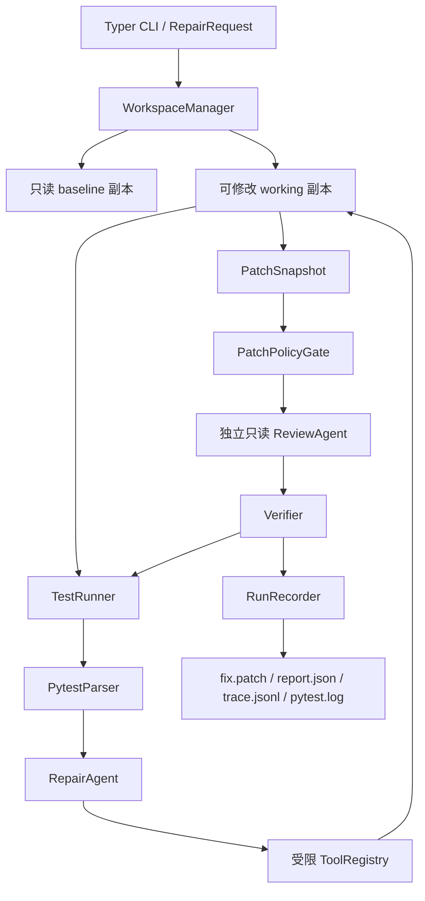

# PyRepair Agent Architecture

## 目标

PyRepair Agent 面向“一个 Python 项目出现可复现 pytest 失败”的场景。它让 LLM 负责收集证据和提出最小源码修改，但把路径权限、补丁规模、测试结果和最终成功判定留给确定性 Python 代码。

MVP 的核心原则是：生成候选补丁，而不是替开发者直接改仓库。

## 组件与数据流

| 组件 | 文件 | 职责 |
| --- | --- | --- |
| CLI 与装配 | `src/pyrepair/cli.py` | 解析参数、读取配置、装配依赖、映射退出码 |
| 协调器 | `src/pyrepair/coordinator.py` | 串联基线、Agent、策略、Review、验证和记录 |
| 工作区 | `src/pyrepair/workspace.py` | 创建 baseline/working 临时副本、恢复重试、计算 Diff、清理 |
| pytest 执行 | `src/pyrepair/testing.py` | 使用参数列表启动子进程，处理超时和启动错误 |
| 失败解析 | `src/pyrepair/pytest_parser.py` | 从 pytest 输出保守提取第一个 node id、异常与相关路径 |
| 修复 Agent | `src/pyrepair/repair_agent.py` | DeepSeek Thinking + Tool Calling 循环，最多 8 次工具调用 |
| 工具注册表 | `src/pyrepair/tools.py` | 暴露读取、搜索、精确替换、Diff、目标测试 5 个工具 |
| 补丁策略 | `src/pyrepair/policy.py` | 拦截受保护路径、测试绕过、断言弱化和过大补丁 |
| 独立 Review | `src/pyrepair/review_agent.py` | 使用全新上下文，只读审查失败证据与候选 Diff |
| 验证器 | `src/pyrepair/verifier.py` | 依次运行目标测试、全量测试、回归比较和最终策略复检 |
| 记录器 | `src/pyrepair/recorder.py` | 原子写入四类可审计产物并脱敏 |
| 模型客户端 | `src/pyrepair/deepseek.py` | 封装 OpenAI-compatible SDK、Thinking、工具调用、重试和 Key 脱敏 |

## 一次修复如何执行

1. CLI 把仓库、测试目标、模型和最大尝试次数转换为 `RepairRequest`。
2. `WorkspaceManager` 在系统临时目录创建 baseline 和 working。后续修改只发生在 working。
3. `TestRunner` 执行基线 pytest；`PytestParser` 保守识别第一个失败 node id。已通过、超时、启动失败和不可解析输出都会提前结束并留下报告。
4. 每轮尝试开始时恢复干净 working。`RepairAgent` 只通过 5 个注册工具读取和修改工作区。
5. Agent 结束后生成 `PatchSnapshot`。没有补丁、工具循环未完成或策略拒绝都不会进入 Review。
6. `ReviewAgent` 获得原始失败和候选 Diff，但没有任何工具，也不共享修复 Agent 的消息历史。
7. `Verifier` 先运行目标测试，再运行全量测试，并将新失败与基线失败集合比较；最后重新执行补丁策略。
8. 只有所有门都通过才返回 `success`。无论成功还是失败，`RunRecorder` 都在原目标仓库的 `.pyrepair/runs/<run-id>` 写入审计产物。

最多进行 3 轮修复尝试。每轮都从 baseline 恢复，上一轮只能以结构化失败证据影响下一轮，不能把未验证修改叠加下去。

## 信任边界

### LLM 可以做什么

- 读取 UTF-8 文本文件。
- 在 Python 文件中搜索字面文本。
- 对唯一匹配做精确替换。
- 查看当前候选 Diff。
- 运行解析器已经选定的目标测试。

### LLM 不能做什么

- 执行任意 Shell 命令或选择任意测试命令。
- 访问临时工作区之外的路径。
- 修改测试、CI、环境文件、密钥、依赖锁或非 Python 文件。
- 自动应用候选补丁到原仓库。
- Commit、Push、创建或评论 Pull Request。
- 宣布自己成功并绕过 Python/pytest 判定。

`PatchPolicyGate` 还限制最多 3 个修改文件和 80 行增删，并检测新增 `skip`/`xfail`、断言删除或比较弱化。

## 产物与可观测性

| 产物 | 内容 | 用途 |
| --- | --- | --- |
| `fix.patch` | 通过验证的 unified diff；失败时为空 | 人工审查和手动应用 |
| `report.json` | 状态、失败原因、尝试与各门结果 | 机器读取和问题定位 |
| `trace.jsonl` | 模型角色、工具名、Token 和停止原因 | 调试 Agent 决策链，不保存 API Key |
| `pytest.log` | baseline、目标测试和全量测试输出 | 复现成功或失败判定 |

敏感字段和当前 API Key 会在写盘前脱敏。运行时产生的 `__pycache__`、`.pytest_cache` 和字节码不会进入候选 Diff。

## 测试与评测

- 普通测试使用 `FakeLLM`，默认离线且不会产生模型费用。
- `live` marker 验证真实 DeepSeek V4 Flash 的 Thinking 和 Tool Calling 协议。
- `benchmarks/` 包含 15 个固定单 Bug 小项目；运行器逐例追加 JSONL，支持 `--case` 和 `--resume`。
- 成功率是包含解析器、策略、Review 与全量回归在内的端到端指标，不等同于模型准确率。

当前 Flash 实测为 13/15（86.7%），两项失败都发生在 pytest 输出解析阶段，详细数据见 [benchmark-results.md](benchmark-results.md)。

## GitHub Actions 边界

- `ci.yml` 在 push/PR 上运行，但完全离线，不读取 `DEEPSEEK_API_KEY`。
- `pyrepair-demo.yml` 只能手动触发，使用仓库 Secret 调用模型，并只上传 Artifact。
- 两条工作流的仓库权限均为 `contents: read`，不存在自动写回或外部 fork Secret 暴露流程。
