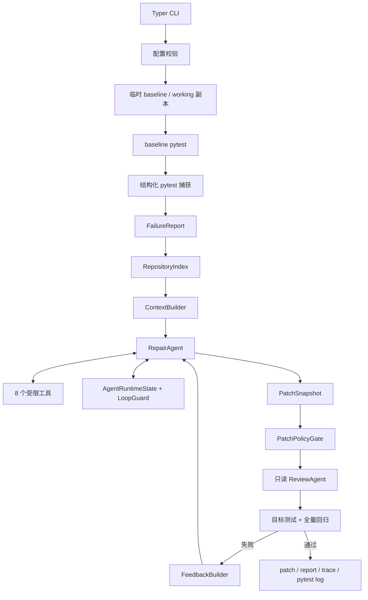

# PyRepair Agent 架构说明

PyRepair 是面向 Python/pytest 项目的候选补丁 Agent。它把概率性的 LLM 诊断放在受限工具循环中，再用确定性 Policy、独立只读 Review 和真实 pytest 执行决定候选补丁能否交付。

## 总体数据流



系统包含两个循环：

- **外层 attempt loop**：由 `RepairCoordinator` 控制，最多 3 次。每轮从 baseline 重建 working，上一轮只能通过结构化反馈影响下一轮。
- **内层 model-tool loop**：由 `RepairAgent` 控制，默认最多执行 8 次工具调用，模型响应轮次上限为 11。

## 组件职责

| 组件 | 文件 | 职责 |
| --- | --- | --- |
| CLI 与组合根 | `src/pyrepair/cli.py` | Typer 命令、配置加载和手动依赖注入 |
| 总协调器 | `src/pyrepair/coordinator.py` | baseline、上下文、attempt、Policy、Review、Verify 和产物收尾 |
| 工作区 | `src/pyrepair/workspace.py` | 创建 baseline/working 临时副本、恢复重试、计算 Diff、清理 |
| 测试执行器 | `src/pyrepair/testing.py` | 以独立子进程运行 pytest，处理超时和启动失败 |
| 结构化捕获 | `src/_pyrepair_agent_internal/pytest_plugin.py` | 通过 pytest hook 记录 collection/setup/call/teardown 失败 |
| 捕获解析 | `src/pyrepair/pytest_capture.py` | 严格校验内部 JSON 报告 |
| 文本降级解析 | `src/pyrepair/pytest_parser.py` | 插件报告不可用时保守解析 pytest 文本 |
| 仓库索引 | `src/pyrepair/repository_index.py` | 用 AST 提取模块、符号和 import 邻居 |
| 上下文构建 | `src/pyrepair/context_builder.py` | 按失败证据排序源码片段并执行字符预算 |
| 工具注册表 | `src/pyrepair/tools.py` | 暴露 8 个受限工具并统一返回结构化结果 |
| 修复角色 | `src/pyrepair/repair_agent.py` | 执行带状态注入的 DeepSeek model-tool loop |
| Agent 状态 | `src/pyrepair/agent_state.py` | 记录工具调用、已读/已改文件和验证状态 |
| 循环守卫 | `src/pyrepair/loop_guard.py` | 阻止重复调用、重复错误、无进展与未验证结束 |
| 重试反馈 | `src/pyrepair/feedback.py` | 汇总补丁、策略、Review、测试和回归证据 |
| 补丁策略 | `src/pyrepair/policy.py` | 确定性检查路径、文件类型、测试绕过、断言弱化和修改范围 |
| 独立 Review | `src/pyrepair/review_agent.py` | 用单独只读模型调用检查根因、最小性和副作用 |
| 最终验证 | `src/pyrepair/verifier.py` | 目标测试短路、全量测试、回归比较和 Policy 复查 |
| 运行记录 | `src/pyrepair/recorder.py` | 原子写入 patch、report、trace 和 pytest 日志并打码敏感值 |

## 失败捕获

`TestRunner` 启动 pytest 时加载内部插件，并通过 `PYREPAIR_PYTEST_REPORT` 指定本次运行唯一的 JSON 报告路径。

正常路径：

1. pytest hook 捕获 collection、setup、call 和 teardown 失败。
2. 插件写出固定版本的 JSON envelope。
3. `load_capture_report()` 严格校验字段、类型、phase 和 duration。
4. `TestRun.failures` 向后续流程提供结构化失败对象。

降级路径：

- 如果旧报告无法删除、插件没有生成报告、报告损坏或 schema 不合法，则不会信任该文件。
- 系统回退到保守文本解析；无法可靠识别 node id 时在调用 LLM 前停止。

这条双路径兼容 pytest 8/9 的常见输出，同时避免把陈旧或格式错误的内部报告当作新证据。

## 确定性上下文

`RepositoryIndex` 只解析 Python 源码，提取：

- 模块路径和模块名；
- 函数、类和方法的起止行；
- `import` / `from ... import ...` 关系；
- 语法错误信息。

`ContextBuilder` 根据 traceback 文件、失败测试、符号定义、import 邻居、摘要标识符、模块相似度和关键词累计打分。候选按分数和稳定次级键排序，最多选 8 个 snippet，总预算 16,000 字符。

每个源码片段都包在：

```xml
<repository_data path="..." trusted="false">
...
</repository_data>
```

仓库正文中的伪造闭合标签会被转义。上下文收集发生异常时，构建器返回空 bundle，修复流程仍可依靠工具按需读取，而不是因为辅助上下文失败而整体退出。

## 8 个受限工具

| 工具 | 权限与用途 |
| --- | --- |
| `read_file` | 分页读取 working 中的 UTF-8 文本 |
| `search_code` | 在仓库内执行受限文本搜索 |
| `find_symbol` | 查询 AST 索引中的函数、类和方法 |
| `find_references` | 查询符号引用位置 |
| `inspect_module` | 查看模块符号、import 和解析状态 |
| `replace_text` | 对 Python 源码中唯一匹配片段执行一次精确替换 |
| `show_diff` | 查看 baseline 到 working 的候选 Diff 和统计 |
| `run_target_test` | 只运行最初识别出的 pytest node id |

所有路径先经过 `resolve_inside()`；解析后的真实路径必须仍位于 working 根目录内，因此 `../` 和指向外部的符号链接不能逃出工作区。工具结果统一附带 `trusted: false` 元数据。

`replace_text` 不提供任意写文件、创建文件、删除文件或 Shell 执行能力。它只负责局部修改；真正的允许/拒绝还要由后续 `PatchPolicyGate` 检查完整快照。

## Agent State 与 Loop Guard

`AgentRuntimeState` 是 model-tool loop 的状态记录器，追踪：

- 已使用工具预算；
- 已读和已修改文件；
- 上一次工具与错误；
- 相同调用连续次数；
- 连续无进展次数；
- 最新编辑后是否重新查看 Diff；
- 最新编辑后是否重新运行目标测试。

调用指纹由“工具名 + 规范化参数 JSON”组成；结果指纹用于判断相同调用是否返回了新证据。对 `run_target_test`，进展判断只保留 target、passed、exit_code 和 timed_out 等稳定字段，避免耗时和原始输出抖动制造虚假进展。

`LoopGuard` 负责工具层活锁：

- 第 3 次连续相同调用前阻断；
- 第 3 次相同调用错误前阻断；
- 连续第 3 次无进展时警告，第 4 次阻断；
- 工具预算不足时提示优先查看 Diff 和运行目标测试。

`CompletionPolicy` 负责收尾层门禁：如果存在修改但最新编辑后没有 `show_diff` 或 `run_target_test`，预算尚存时要求模型继续；预算耗尽时以 `required_verification_missing` 失败。

状态记录不能替代磁盘事实。候选修改最终仍由 `WorkspaceSession.snapshot()` 比较 baseline/working 得到，测试结论仍来自真实 pytest。

## 外层 attempt 与反馈

每轮 attempt 的顺序是：

1. 从 baseline 恢复 working。
2. 重建 `ToolRegistry` 和 AST 索引。
3. 执行 RepairAgent。
4. 从磁盘生成 `PatchSnapshot`。
5. 执行 Policy 预检。
6. 执行独立只读 Review。
7. 执行目标测试和全量回归。
8. 成功则写入候选补丁；失败则生成 `AttemptFeedback`。

`AttemptFeedback` 包含候选 Diff、Policy 违规、Review findings、目标测试失败、回归失败和下一步聚焦建议。Diff、测试输出和 findings 都有长度上限，下一轮收到的数据继续标记为不可信。

每轮都会恢复干净副本，因此上一轮未验证修改不会直接叠加到下一轮。

## Policy、Review 与 Verify

### Policy Gate

确定性 Policy 检查：

- 测试、环境、CI、锁文件和常见密钥文件；
- 非 Python 源码修改；
- 新增 skip/xfail；
- 删除断言或减少比较型断言；
- 超过 3 个文件或 80 行的补丁。

### 只读 Review

`ReviewAgent` 使用单独的 System Prompt 和单独一次模型调用，只接收原始失败和候选 Diff，不拥有工具，也不能修改代码。它与 RepairAgent 默认使用同一个 DeepSeek client，因此“独立”指角色、上下文和调用隔离，不表示使用另一个模型。

Review JSON 必须满足严格 schema；无法解析时默认返回高风险拒绝。

### Verifier

Verifier 的顺序是：

1. 运行目标测试；失败时短路，不运行全量测试。
2. 目标通过后运行完整 pytest。
3. 计算“当前失败集合 - baseline 已知失败集合”得到新增回归。
4. 对同一 `PatchSnapshot` 再执行一次 Policy。

`VerificationResult.passed` 必须同时满足：

```text
target_passed
AND full_suite_passed
AND no regression_failures
AND final patch_check.allowed
```

当前语义要求完整测试套件退出码为 0。因此，带有无关预存在失败的仓库需要后续设计更明确的全量 baseline/允许失败策略。

## 信任边界

- 原仓库只作为复制源；Agent 工具只收到 working 路径。
- baseline 是逻辑不可修改的比较基准，但不是通过操作系统权限设为只读。
- LLM 自述不决定成功；Coordinator 总是检查磁盘快照和真实测试结果。
- Review 是额外的概率性语义门禁，不能替代确定性 Policy 和 pytest。
- pytest 会执行项目代码；临时副本避免污染原仓库，但不提供容器或虚拟机级隔离。
- 因此，PyRepair 当前只应运行在可信仓库上。

## 运行产物

每次运行在原仓库的 `.pyrepair/runs/<run-id>/` 创建四个文件：

| 文件 | 内容 |
| --- | --- |
| `fix.patch` | 通过全部门禁后的候选 Diff；未成功时保持为空 |
| `report.json` | 最终状态、失败报告和每轮 attempt 证据 |
| `trace.jsonl` | baseline、模型轮次和 run_finished 事件 |
| `pytest.log` | baseline、目标与全量 pytest 的原始输出 |

产物写入采用临时文件替换，API Key 等敏感值会在结构化字段和字符串中打码。临时 baseline/working 会在 Coordinator 的 `finally` 中清理。

## 评测

固定 benchmark 位于 `benchmarks/cases/`，manifest 定义 15 个小型、可复现单 Bug 任务。runner 为每个 case 创建独立临时目录，逐条追加原始 JSONL，并从该文件生成 Markdown 报告。

最新结果和失败明细始终以 [benchmark-results.md](benchmark-results.md) 为准。该指标衡量整条 PyRepair 修复链路，不是单独的模型准确率，也不代表大型真实仓库的通用修复率。

## 当前设计限制

- 仅支持 Python/pytest 和已有源码内的精确文本替换。
- working 内编辑后不会增量刷新本轮 AST 索引。
- 测试保护仍以路径和静态启发式为主。
- 完整测试套件必须全部通过，预存在失败语义尚未单独建模。
- 临时副本不是执行不可信代码的安全沙箱。
