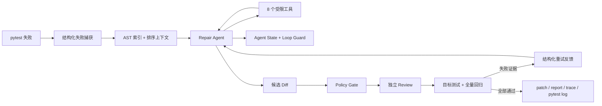

# PyRepair Recruiter-First README Refresh Implementation Plan

> **For agentic workers:** REQUIRED SUB-SKILL: Use superpowers:subagent-driven-development (recommended) or superpowers:executing-plans to implement this plan task-by-task. Steps use checkbox (`- [ ]`) syntax for tracking.

**Goal:** Publish a Chinese, recruiter-first README whose architecture claims and benchmark metrics are backed by the current PyRepair source, tests, and a fresh 15-case `deepseek-v4-flash` run.

**Architecture:** Treat the benchmark JSONL as the metric source of truth, executable documentation tests as the README fact gate, and the current Python modules as the architecture source of truth. Update the linked architecture document together with README so the public documentation presents one consistent eight-tool, context-aware, stateful Agent Loop.

**Tech Stack:** Markdown, Mermaid, Python 3.11+, pytest, Ruff, PowerShell, DeepSeek OpenAI-compatible API, Git/GitHub.

## Global Constraints

- Primary audience is Python / Agent development internship interviewers; secondary audience is developers running the CLI.
- Chinese is the primary language; established English technical terms remain untranslated where clearer.
- The benchmark must be a new, non-resumed 15-case `deepseek-v4-flash` run.
- Benchmark failures remain in the raw JSONL and reported metrics; do not edit or omit failed cases.
- End-to-end benchmark success rate must never be described as model accuracy.
- Do not add Docker, MCP, automatic patch application, Commit, Push, or PR behavior.
- Do not add a CI-passing badge while GitHub Actions is blocked by account billing state.
- Use only project-related files and ordinary fast-forward pushes; never force-push.

---

## File Structure

- Modify `README.md`: recruiter-first overview, current Agent Loop, quick start, safety boundary, fresh metrics, source map, limitations, and roadmap.
- Modify `docs/architecture.md`: replace the stale five-tool/parser description with the current repository index, context builder, eight tools, Agent State, Loop Guard, and feedback loop.
- Modify `docs/benchmark-results.md`: generated by the benchmark runner from the new result set without hand-editing its metrics.
- Create: the timestamped `benchmarks/results/*-deepseek-v4-flash.jsonl` path printed by the fresh benchmark run; it is append-only raw evidence.
- Modify `tests/test_readme_commands.py`: executable documentation assertions that reject the stale five-tool and pytest-9 claims and require current sections.

---

### Task 1: Produce a Fresh 15-Case Benchmark Record

**Files:**
- Create: the new timestamped `benchmarks/results/*-deepseek-v4-flash.jsonl` printed by Step 2
- Modify: `docs/benchmark-results.md`

**Interfaces:**
- Consumes: `DEEPSEEK_API_KEY`, `benchmarks/manifest.json`, `benchmarks/run_benchmark.py`, model name `deepseek-v4-flash`.
- Produces: one JSON object per case with `case_id`, `status`, `attempts`, `duration_seconds`, token counts, regression count, policy rejection count, failure reason, changed files, and candidate patch.

- [ ] **Step 1: Verify benchmark preconditions without exposing the API key**

Run:

```powershell
if ([string]::IsNullOrWhiteSpace($env:DEEPSEEK_API_KEY)) {
    throw "DEEPSEEK_API_KEY is not configured in this PowerShell session."
}
.\.venv\Scripts\python.exe -m pytest -p no:cacheprovider `
    --basetemp .\tmp\pytest-readme-preflight `
    tests/test_benchmark_manifest.py tests/test_benchmark_runner.py -q
```

Expected: API key presence check prints no secret, and benchmark unit tests pass.

- [ ] **Step 2: Run every case from a new result file**

Run:

```powershell
$before = @(Get-ChildItem benchmarks\results\*-deepseek-v4-flash.jsonl).FullName
.\.venv\Scripts\python.exe benchmarks\run_benchmark.py `
    --model deepseek-v4-flash
$created = @(Get-ChildItem benchmarks\results\*-deepseek-v4-flash.jsonl |
    Where-Object FullName -NotIn $before)
if ($created.Count -ne 1) {
    throw "Expected one new benchmark result file, got $($created.Count)."
}
Write-Output "NEW_RESULT=$($created[0].FullName)"
```

Expected: console prints `case_01` through `case_15`, a new JSONL path, the Markdown report path, and a 15-case success-rate summary. Do not add `--resume`.

- [ ] **Step 3: Verify the generated result set is complete and internally consistent**

Run using the newest file created by Step 2:

```powershell
$resultPath = Get-ChildItem benchmarks\results\*-deepseek-v4-flash.jsonl |
    Sort-Object LastWriteTimeUtc -Descending |
    Select-Object -First 1
$records = @(Get-Content -LiteralPath $resultPath.FullName |
    ForEach-Object { $_ | ConvertFrom-Json })
if ($records.Count -ne 15) { throw "Expected 15 records, got $($records.Count)." }
if (@($records.case_id | Sort-Object -Unique).Count -ne 15) {
    throw "Benchmark contains duplicate or missing case IDs."
}
if (@($records | Where-Object model -ne 'deepseek-v4-flash').Count -ne 0) {
    throw "Benchmark contains a different model."
}
if (@($records | Where-Object { $_.status -notin @('success', 'failed', 'error') }).Count -ne 0) {
    throw "Benchmark contains an unknown status."
}
```

Expected: command exits successfully. A failed or error case is valid evidence and must remain in the file.

- [ ] **Step 4: Confirm the report points to the new JSONL**

Run:

```powershell
Get-Content docs\benchmark-results.md | Select-Object -First 20
```

Expected: `Raw results` names the new file, model status is `deepseek-v4-flash | Evaluated`, and summary case count is 15.

- [ ] **Step 5: Commit the raw evidence and generated report**

```powershell
$resultPath = Get-ChildItem benchmarks\results\*-deepseek-v4-flash.jsonl |
    Sort-Object LastWriteTimeUtc -Descending |
    Select-Object -First 1
git add $resultPath.FullName docs/benchmark-results.md
git commit -m "bench: refresh DeepSeek V4 Flash evaluation"
```

---

### Task 2: Add a Documentation Fact Gate and Rewrite README

**Files:**
- Modify: `tests/test_readme_commands.py`
- Modify: `README.md`

**Interfaces:**
- Consumes: fresh `docs/benchmark-results.md`, current CLI commands, the eight tool names exposed by `ToolRegistry`, and current test output.
- Produces: a recruiter-first Chinese README and a deterministic test that prevents stale architecture claims from returning.

- [ ] **Step 1: Add failing assertions for the current README contract**

Replace `tests/test_readme_commands.py` with:

```python
from pathlib import Path

PROJECT_ROOT = Path(__file__).parents[1]


def test_readme_documents_real_commands() -> None:
    readme = (PROJECT_ROOT / "README.md").read_text(encoding="utf-8")

    assert "pip install -e ." in readme
    assert "pyrepair fix" in readme
    assert "python -m pytest" in readme
    assert "安全边界" in readme
    assert "benchmark" in readme.lower()


def test_readme_describes_the_current_agent_harness() -> None:
    readme = (PROJECT_ROOT / "README.md").read_text(encoding="utf-8")

    required = (
        "AST 仓库索引",
        "8 个受限工具",
        "Agent State",
        "Loop Guard",
        "结构化重试反馈",
        "目标测试 + 全量回归",
        "端到端成功率",
    )
    assert all(text in readme for text in required)
    assert "5 个工具" not in readme
    assert "尚未覆盖 pytest 9" not in readme


def test_readme_keeps_candidate_patch_boundary_explicit() -> None:
    readme = (PROJECT_ROOT / "README.md").read_text(encoding="utf-8")

    assert "不直接修改原仓库" in readme
    assert "不自动 Commit" in readme
    assert "不自动 Push" in readme
    assert "不自动创建 PR" in readme
```

- [ ] **Step 2: Run the README test and verify it fails for stale content**

Run:

```powershell
.\.venv\Scripts\python.exe -m pytest -p no:cacheprovider `
    --basetemp .\tmp\pytest-readme-red tests\test_readme_commands.py -q
```

Expected: at least `test_readme_describes_the_current_agent_harness` fails because the old README still says five tools and omits the new state/context terminology.

- [ ] **Step 3: Rewrite README with the approved recruiter-first structure**

Use these exact top-level sections, in order:

```markdown
# PyRepair Agent

> 面向 Python/pytest 项目的安全候选补丁 Agent：让 LLM 负责诊断与最小修改，让确定性规则、独立 Review 和 pytest 决定能否交付。

## 30 秒看懂
## 为什么不是“再做一个 Claude Code”
## 核心技术亮点
## Agent Loop
## 快速开始
## 安全边界
## Benchmark 实测
## 测试与复现
## 代码导读
## 当前局限
## 路线图
```

The “核心技术亮点” table must map each mechanism to its engineering value:

```markdown
| 机制 | 工程价值 |
| --- | --- |
| AST 仓库索引 | 定位函数、类、方法、import 邻居，减少盲目全文搜索 |
| 确定性上下文构建 | 按失败证据排序，并以字符预算控制输入规模 |
| 8 个受限工具 | 只允许读取、搜索、符号查询、精确替换、Diff 和目标测试 |
| Agent State + Loop Guard | 检测重复调用、重复错误和无进展循环 |
| 结构化重试反馈 | 把补丁、策略、Review、目标测试和回归证据传给下一轮 |
| 多重验证门禁 | Policy、独立 Review、目标测试、全量回归共同判定 |
```

The Mermaid graph must show this data flow:



Populate the benchmark table only from Task 1's fresh report. State directly below it: “这是 PyRepair 整条修复链路的端到端成功率，不是单独的模型准确率。” List every failed/error case and its real reason.

- [ ] **Step 4: Run the README fact gate**

Run:

```powershell
.\.venv\Scripts\python.exe -m pytest -p no:cacheprovider `
    --basetemp .\tmp\pytest-readme-green tests\test_readme_commands.py -q
```

Expected: all README tests pass.

- [ ] **Step 5: Commit README and its fact gate**

```powershell
git add README.md tests/test_readme_commands.py
git commit -m "docs: present PyRepair as a stateful repair agent"
```

---

### Task 3: Synchronize the Linked Architecture Document

**Files:**
- Modify: `docs/architecture.md`
- Modify: `tests/test_readme_commands.py`

**Interfaces:**
- Consumes: the public README terminology and current source modules.
- Produces: a linked deep-dive document that agrees with README about tool count, context, state, loop guards, feedback, and structured pytest capture.

- [ ] **Step 1: Add a failing architecture consistency test**

Append to `tests/test_readme_commands.py`:

```python
def test_architecture_document_matches_current_harness() -> None:
    architecture = (PROJECT_ROOT / "docs/architecture.md").read_text(encoding="utf-8")

    required = (
        "RepositoryIndex",
        "ContextBuilder",
        "8 个受限工具",
        "AgentRuntimeState",
        "LoopGuard",
        "FeedbackBuilder",
        "结构化 pytest",
    )
    assert all(text in architecture for text in required)
    assert "5 个工具" not in architecture
    assert "当前 Flash 实测为 13/15" not in architecture
```

- [ ] **Step 2: Run the consistency test and verify it fails**

Run:

```powershell
.\.venv\Scripts\python.exe -m pytest -p no:cacheprovider `
    --basetemp .\tmp\pytest-architecture-red `
    tests\test_readme_commands.py::test_architecture_document_matches_current_harness -q
```

Expected: FAIL because the current architecture document still describes five tools and the old 13/15 result.

- [ ] **Step 3: Update architecture components and flow**

Add component rows for these exact modules and responsibilities:

```markdown
| 仓库索引 | `src/pyrepair/repository_index.py` | 用 AST 提取模块、符号和 import 邻居 |
| 上下文构建 | `src/pyrepair/context_builder.py` | 按失败证据排序源码片段并执行字符预算 |
| Agent 状态 | `src/pyrepair/agent_state.py` | 记录工具调用、已读/已改文件和验证状态 |
| 循环守卫 | `src/pyrepair/loop_guard.py` | 阻止重复调用、重复错误、无进展与未验证结束 |
| 重试反馈 | `src/pyrepair/feedback.py` | 汇总补丁、策略、Review、测试和回归证据 |
```

Replace “5 个工具” with “8 个受限工具” and list `read_file`, `search_code`, `find_symbol`, `find_references`, `inspect_module`, `replace_text`, `show_diff`, and `run_target_test`. Describe structured pytest plugin capture with conservative text fallback. Remove the hard-coded old 13/15 sentence and link readers to `benchmark-results.md` for the latest run.

- [ ] **Step 4: Run documentation consistency tests**

Run:

```powershell
.\.venv\Scripts\python.exe -m pytest -p no:cacheprovider `
    --basetemp .\tmp\pytest-docs-green tests\test_readme_commands.py -q
```

Expected: all documentation tests pass.

- [ ] **Step 5: Commit the architecture synchronization**

```powershell
git add docs/architecture.md tests/test_readme_commands.py
git commit -m "docs: synchronize PyRepair architecture guide"
```

---

### Task 4: Verify, Review, Merge, and Publish

**Files:**
- Verify: `README.md`
- Verify: `docs/architecture.md`
- Verify: `docs/benchmark-results.md`
- Verify: the newest tracked `benchmarks/results/*-deepseek-v4-flash.jsonl`
- Verify: `tests/test_readme_commands.py`

**Interfaces:**
- Consumes: all Task 1–3 deliverables.
- Produces: a reviewed local `main` and matching GitHub `origin/main`.

- [ ] **Step 1: Verify no stale claims or unrelated files remain**

Run:

```powershell
$stale = @(rg -n "5 个工具|尚未覆盖 pytest 9|当前 Flash 实测为 13/15" README.md docs/architecture.md)
if ($stale.Count -ne 0) { $stale; throw "Stale documentation claims remain." }
git diff --check
git status --short
```

Expected: no stale matches, no whitespace errors, and only the expected task files are changed before their respective commits.

- [ ] **Step 2: Run full offline verification**

Run:

```powershell
.\.venv\Scripts\python.exe -m pytest -p no:cacheprovider `
    --basetemp .\tmp\pytest-readme-final --cov=pyrepair --cov-report=term-missing
.\.venv\Scripts\python.exe -m ruff check src tests benchmarks
.\.venv\Scripts\python.exe -m build --wheel --outdir .\tmp\dist-readme-final
```

Expected: all selected offline tests pass, coverage is reported, Ruff prints `All checks passed!`, and wheel construction succeeds.

- [ ] **Step 3: Request a read-only code/documentation review**

Review the implementation range against `docs/superpowers/specs/2026-08-26-readme-recruiter-first-refresh-design.md`. Fix all Critical and Important findings, rerun Step 2, and obtain `Ready to merge? Yes`.

- [ ] **Step 4: Integrate through the development-branch workflow**

Use `superpowers:finishing-a-development-branch`. Merge the feature branch into local `main`, rerun the full offline test command on merged `main`, remove the owned worktree, and delete the merged feature branch.

- [ ] **Step 5: Push with ordinary fast-forward semantics**

Run:

```powershell
git push origin main
git status --short --branch
git rev-parse main
git rev-parse origin/main
```

Expected: push succeeds without `--force`, status shows `main...origin/main`, and both revisions are identical.
